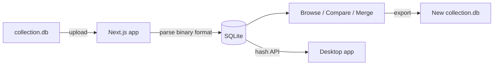

# osu! Collection Hub: Web App

Share osu! beatmap collections with friends without passing files around.

My friends and I kept sending each other `collection.db` files and then hunting down every missing map by hand. This web app is the shared hub: everyone uploads their collections, and anyone in the group can browse, compare, or merge them. Pair it with the [desktop app](https://github.com/ryelae/OsuCollectorDesktopApp), which downloads the missing maps and imports collections straight into osu!.

<!-- Screenshot: add a screenshot of the uploads or compare page here, e.g.  -->

---

## What it does

| Feature     | Details                                                                            |
| ----------- | ---------------------------------------------------------------------------------- |
| **Upload**  | Drag and drop `collection.db`, pick which collections to include, name yourself    |
| **Browse**  | View all uploads, every collection, and its map count                              |
| **Compare** | Put two people's uploads side by side and see shared and unique maps per collection |
| **Merge**   | Combine collections from different people and export a new `collection.db`         |
| **Share**   | Each upload has a permanent shareable link                                         |
| **Auth**    | Optional shared password (env var), off by default for local use                   |

---

## How it works



A few of the interesting parts:

- **Binary format parser and writer.** osu! stores collections in a custom binary format (ULEB128 length prefixed strings, little endian ints). The app parses uploads on the server and can write a brand new `collection.db` for merged exports. A round trip test suite covers edge cases like empty names, UTF-8 names, and malformed files.
- **Browser side preview.** A lightweight parser runs in the browser so you can see collection names and counts and pick what to upload before anything is sent.
- **API for the desktop app.** The desktop app pulls beatmap hashes per collection from a small REST endpoint.
- **Deployment.** Hosted on Fly.io with a persistent volume for SQLite, plus a GitHub Actions deploy workflow.

---

## Companion desktop app

The [desktop app](https://github.com/ryelae/OsuCollectorDesktopApp) connects to this web app and adds:

- Browsing uploaded collections from other users
- Resolving missing beatmap hashes via the osu! API v1
- Downloading missing `.osz` files directly to your osu! Songs folder
- Writing imported collections into your local `collection.db`
- Light/dark mode, auto-detected osu! path, multiple download mirrors

---

## Supported osu! client

**osu! stable only.** The app reads and writes the legacy `collection.db` binary format.
osu!lazer uses a different format and is not supported. I may start working on a lazer solution soon if my friends make the switch.

---

## Quick start (local)

### Prerequisites

- Node.js 18+
- npm 9+

### 1. Clone and install

```bash
git clone <your-repo-url>
cd OsuCollectorWebApp
npm install
```

### 2. Configure environment

```bash
cp .env.example .env.local
# Edit .env.local: set APP_PASSWORD or leave blank for open access
```

### 3. Run

```bash
npm run dev
# Open http://localhost:3000
```

Data is stored in `./data/` (SQLite DB + uploaded files). This directory is gitignored.

---

## Configuration

| Variable           | Default            | Description                                                                            |
| ------------------ | ------------------ | -------------------------------------------------------------------------------------- |
| `APP_PASSWORD`     | _(not set)_        | If set, the app requires this password to access. Leave unset for open/local-only use. |
| `MAX_UPLOAD_BYTES` | `52428800` (50 MB) | Maximum `collection.db` upload size in bytes.                                          |

---

## Auth / private mode

A single shared password set via `APP_PASSWORD`.

- **No `APP_PASSWORD` set** → fully open. Fine for local use on a private machine.
- **`APP_PASSWORD` set** → shows a login page. Enter the password to get a 30-day session cookie.

There is no per-user auth; anyone with the password can see and delete all uploads. This is intentional for a small private group.

---

## How to find collection.db

On **Windows**, open File Explorer and paste this in the address bar:

```
%APPDATA%\osu!\collection.db
```

Typical path: `C:\Users\<you>\AppData\Roaming\osu!\collection.db`

Make sure osu! is **closed** before copying the file to avoid partial reads.

---

## Deployment

### Option A: Fly.io (recommended)

```bash
fly launch
fly secrets set APP_PASSWORD=your_secret
fly deploy
```

Mount a persistent volume at `/app/data` for the SQLite DB and uploaded files.

### Option B: Node.js server

```bash
npm run build
APP_PASSWORD=secret npm start
# Runs on port 3000
```

### Option C: Docker

```bash
docker build -t osu-collection-hub .
docker run \
  -p 3000:3000 \
  -e APP_PASSWORD=your_secret \
  -v $(pwd)/data:/app/data \
  osu-collection-hub
```

---

## Running tests

```bash
npm test
```

Tests cover the binary parser and writer (round-trip, edge cases, error handling).

---

## Tech stack

| Layer     | Technology                          |
| --------- | ----------------------------------- |
| Framework | Next.js 14 (App Router), TypeScript |
| Styling   | Tailwind CSS, light + dark mode     |
| Database  | SQLite via better-sqlite3           |
| Auth      | Shared password, SHA-256 cookie     |
| Hosting   | Fly.io (persistent volume)          |

---

## Project structure

```
src/
  lib/
    collection-parser.ts   # Binary collection.db parser
    collection-writer.ts   # Binary collection.db writer
    collection-preview.ts  # Browser-safe preview parser (names + counts only)
    db.ts                  # SQLite layer (better-sqlite3)
    auth.ts                # Shared-password auth helpers
    utils.ts               # Shared utilities
  middleware.ts            # Auth guard (edge runtime)
  app/
    (app)/                 # Route group, all guarded pages
      layout.tsx           # App shell with nav
      page.tsx             # Home / dashboard
      uploads/             # Upload list + upload form
      compare/             # Compare picker + compare detail
      merge/               # Merge builder + export
    login/                 # Standalone login page
    api/
      uploads/             # POST (upload), GET list, GET/DELETE by id
      uploads/[id]/collections/[collectionId]/hashes/  # GET hashes for desktop app
      export/              # POST → binary collection.db download
      auth/login|logout    # Session management
  components/
    nav.tsx                # Sidebar navigation + theme toggle
    upload-form.tsx        # Drag-drop upload form with collection picker
    merge-builder.tsx      # Interactive merge/export UI
data/                      # Runtime data (gitignored)
  db.sqlite
  uploads/
```

---

## Known limitations

- **Private / small-scale only.** No rate limiting, no per-user isolation, no audit log.
- **osu! stable format only.** osu!lazer's `client.realm` format is not supported.
- **Single shared password.** There is no per-user account system.
- **Local file storage.** Uploaded files live on disk next to the app. Back up `./data/` regularly.

## Roadmap

- **Video / no video downloads.** Downloads currently default to including video. Still working on this one.
- **Difficulty names.** Each difficulty currently shows only the song name, so difficulties are hard to tell apart.
